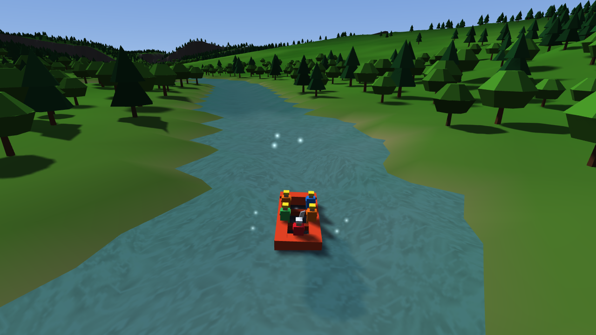

# Forward Two

An open-world river game for the browser. Paddle the Long Water from Tarn
Spring in the mountains, over the High Falls, through the Meadows and the
Gorge, across Mirror Lake and out to the sea at Saltmouth. Run rapids on the
guide's call, carry cargo between camps, race the buoyed courses against other
paddlers' ghosts, and share the river with whoever else is on it.

Forward Two is the sequel to [Forward One](https://github.com/McElyea/forward-one)
by Jon McElyea. It keeps Forward One's guide calls and timing gate, and opens
the map: travel is the game, and rhythm is how you get through the hard water.



## Play

- **Flat water:** paddle where you like. `W`/`↑`/`Space` forward, `S`/`↓`
  back, `A` `D` or `←` `→` to turn. On a phone, use the big buttons.
- **Rapids:** the guide calls *Forward, Back, Left, Right* on the beat. Hit
  each call as its marker reaches the gate. Clean strokes keep your line and
  fill the flow meter. Misses hit the rocks, and too many put you in the river.
- **Camps:** `E` to go ashore. Rest, change boats, take delivery jobs, or take
  the shuttle truck back to any camp you've found.
- `M` map, `J` journal, `1` `2` `3` wave, flare, bell.

## Run it locally

The game is static files plus a prebuilt engine (`web/engine/`), so any static
server works. The bundled server also hosts multiplayer:

```sh
node server/main.js --static web --port 8790   # Node 22, no npm install
```

Then open <http://localhost:8790>. Useful URL options: `?world=small` (a
lighter world for phones), `?seed=N`, `?hour=6.5`, `?new=1`, `?skip=1`.

## How it's built

- **Engine:** [Strata](https://github.com/Preponderous-Software/strata) 0.10.0
  through its web kit. `engine/bridge.cpp` is a small host that draws whatever
  the page hands it: terrain, meshes, textures and per-frame rows.
  `tools/build-engine.sh` rebuilds `web/engine/` (emsdk 6.0.11).
- **Game:** plain ES modules under `web/src/`, with no build step. World
  generation (`world/`) and simulation (`sim/`) never touch the DOM, so the
  tests run them directly.
- **Multiplayer:** `server/` is a dependency-free Node service. It runs live
  rooms (other boats, emotes, group race starts) and stores ghosts and boards.
  With no server, the game keeps ghosts and times on the device.

The design is in [docs/rfc/0001-forward-two.md](docs/rfc/0001-forward-two.md).

```sh
npm test    # node --test
```

## License

MIT; see [LICENSE](LICENSE). Strata's web-kit scripts in `web/engine/` are MIT
(Strata). The guide's voice is generated with Kokoro-82M (Apache-2.0); see
`web/audio/guide/LICENSE.md`.
