# Boats and people: playtest notes (0.2.0)

Polish pass, "boats and people" lane. The owner's feedback was "visuals still
need work", and that included the boats and the people in them: the raft and
paddlers were blocky boxes that showed little life.

## How the stills were taken

- `python3 -m http.server 8836 --directory web`, then
  `boat-shots.cjs "http://127.0.0.1:8836/?server=off&world=tiny"` (the
  script is next to these notes). It loads the game once with `?drive=1`,
  puts each boat on the Long Water at 11:00, and takes canvas stills
  (`toDataURL`). Each shot is a few frames into a stroke, so the crew is
  mid-stroke. The kept stills are JPEG (quality 85, ~0.8 MB in all). The side
  and chase shots were looked at during the pass and not kept.
- `before-*` are from main (`3cbb443`, the base of `local/f2-boats`), `after-*` from this lane's
  working tree. Same seed, same world (`tiny`), same camera set-ups.

| Shot | What it shows |
| --- | --- |
| `{before,after}-{raft,kayak,canoe,dory}-close.jpg` | Three-quarter view from the bow, 7 frames into a forward stroke |
| `{before,after}-{raft,kayak}-rapid.jpg` | The chase camera in the first class III+ rapid |
| `after-ghost-kayak.jpg` | A ghost kayak (translucent, lite rig) paddling past the player |
| `after-raft-left-turn.jpg` | Chase camera, 9 frames into a LEFT turn stroke: the right-side paddlers (and the guide) pull forward, the left side back-paddles. The script logs `kit.project` of the boat's local ±z: +z (crew side +1) lands at screen x 524 against the centre's 488, so side +1 is screen-right. At that frame the right side's blades are at sweep +0.57 on a forward stroke and the left side's at -0.57 on a back stroke |
| `after-swim-raft.jpg` | After a flip: the swimmer beside the upturned raft (feet downstream, head and PFD up). The script also has a `swim-kayak-rapid` shot, but in `tiny` it lands on the water shelf below and reads poorly, so it isn't kept |

## What changed

- **Hulls** are lofted from cross-sections instead of boxes: tapered ends,
  rocker and sheer, flat-shaded curves.
  - Raft: a round-ended tube ring with kicked-up ends, a darker rub strip, a
    perimeter grab line, two cross-tube thwarts, a floor, the guide's cooler
    and a dry bag.
  - Kayak: a crowned deck, cockpit coaming and spray deck, deck bungees and
    grab toggles.
  - Canoe: tumblehome sides with a sheer stripe, wooden gunwales, cane seats,
    a centre thwart, deck plates, a dry bag and a pack.
  - Dory: flared hard-chine sides with high sheer, a transom, decked hatches
    at both ends, a rower's seat, thwarts, oarlocks and a stem post. It now
    carries two passengers as well as the rower.
- **People**: a seated paddler has a torso, a PFD in a bright colour with a
  collar and a waist strap, a neck, a head with sunglasses, a helmet with a
  brim, shoulders, upper arms, forearms and hands on the paddle, and legs
  (seated on the raft's tubes, kneeling in the canoe's bow, sitting in the
  dory). Five looks vary PFD, shirt, helmet and skin, so a raft crew reads as
  five different people. The guide wears red with a dark helmet.
- **Paddling** is synced to the strokes. Every stroke runs catch, drive, exit
  and recovery. The torso twists and leans forward, and the blade goes in at
  the bow, pulls back buried and comes out feathered. On a raft, a turn call
  has one side paddle forward and the other back, as a guide calls it. The
  guide trails a rudder between strokes. Kayak strokes alternate sides, and
  a turn is a sweep on the outside. Dory oars pull and push separately (a
  pivot turn) and feather flat on the recovery.
- **Life**: the boat heaves, pitches and rolls with the water, more in
  rapids. The crew leans into turns and, in rough water, sits forward. The
  bow lifts with speed. Everyone breathes a little when idle.
- **Water effects**: a bow wave and spray that grow with speed, a V-shaped
  wake that flows out behind the stern, a splash when each blade goes in,
  swirl while it pulls, and drips on the recovery.
- **The swimmer** after a flip is a person, not the old yellow sphere: on
  their back in the whitewater swim position, feet pointing downstream (along
  the current, or the heading in still water), head and PFD up out of the
  water. They bob and roll with the water, more in rapids, and both arms
  scull at the surface. The crew leaves the upturned boat while they swim and
  is back aboard when they climb in.
- **Steering sides** follow the fixed (no longer mirrored) sim: a left
  stroke swings the bow screen-left. On a left turn, the raft's right side
  (starboard, crew side +1) paddles forward and the left side back. A kayak
  sweeps on the outside (right), and a dory pulls the right oar and pushes the
  left. The crew leans toward the inside of the turn on screen.
- **The upturned boat** floats bottom up on the surface after a flip: the
  raft's floor (dark underside) and tubes ride above the water, with foam
  slapping round the hull.
- **Other players and ghosts** use the same hulls and crews, through the
  "lite" rig (two meshes: the hull with the crew baked in, and the paddles
  sweeping as a group, or the kayak's paddle with its full motion). They
  paddle on their own from their speed and turning, since the network only
  sends positions. Ghosts are pale and translucent.

## Budget

Strata allows at most 256 meshes. The player's boat uses 1 mesh for the hull,
2 for each paddler and 3 for the swimmer, who stays hidden until a flip
(raft 14, kayak 6, canoe 8, dory 9). A remote boat or
ghost uses 2, and the pool is capped at 48 meshes (it was 24 slots of 1).

Triangles for a whole boat: raft ~2.6k, kayak ~0.65k, canoe ~1.4k, dory ~1.7k
(a person is ~250). The boxes were ~0.4k. That's still small for a phone; the
forest dominates.

## Findings / follow-ups

- The arms are built for a mid-stroke pose: the upper arm rides the torso and
  the forearm rides the paddle. At the extremes of a stroke the elbow opens a
  small gap (a few cm). It isn't visible from the chase camera.
- Remote boats don't send stroke timing, so their cadence is invented. If the
  net protocol ever carries a stroke bit, the rig can take it directly
  (`drive()` already reads `stroke`/`strokeT` when present).
- **Stepped water shelf (the visuals lane's area, not fixed here).** In the `tiny`
  world the first class III+ rapid sits where the river's water sheet steps
  down a terrace. In `*-rapid.jpg` the boat floats on a flat shelf of water
  that ends in a hard edge, with dry grass beyond and a lower sheet further
  on. It's in both the before and the after stills, so it's the water and
  terrain meshes (meshes.js / terrain.js), not the boats.
- Other players' and ghosts' boats still just flip on a swim. Their lite rig
  has no swimmer, to keep their mesh count at 2.

## Screenshots

| | Before (0.1.0) | After |
|---|---|---|
| **Raft and crew** | 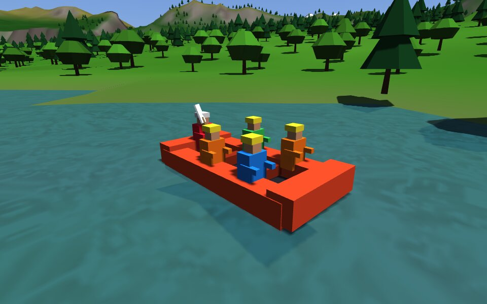 | 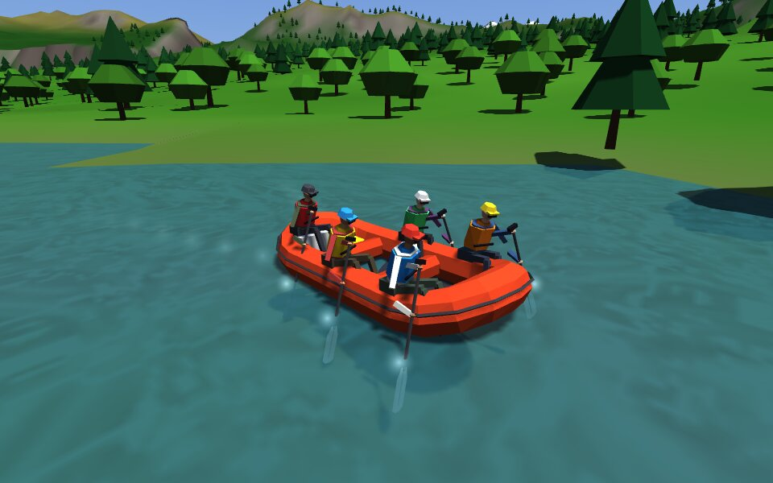 |
| **Kayak** | 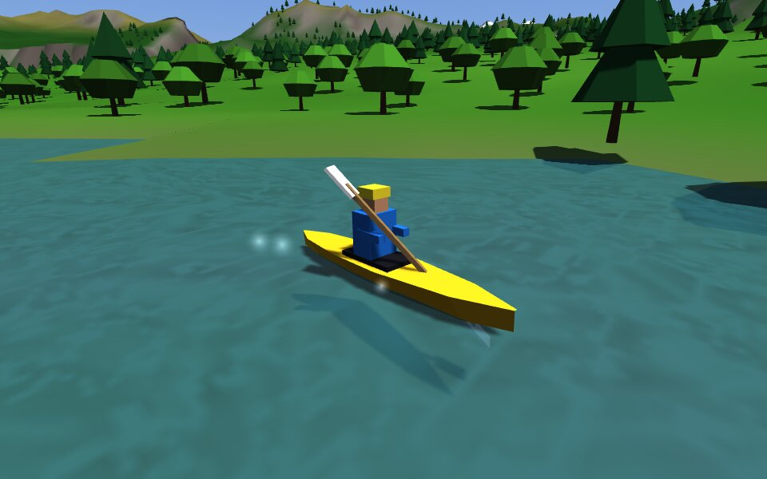 | 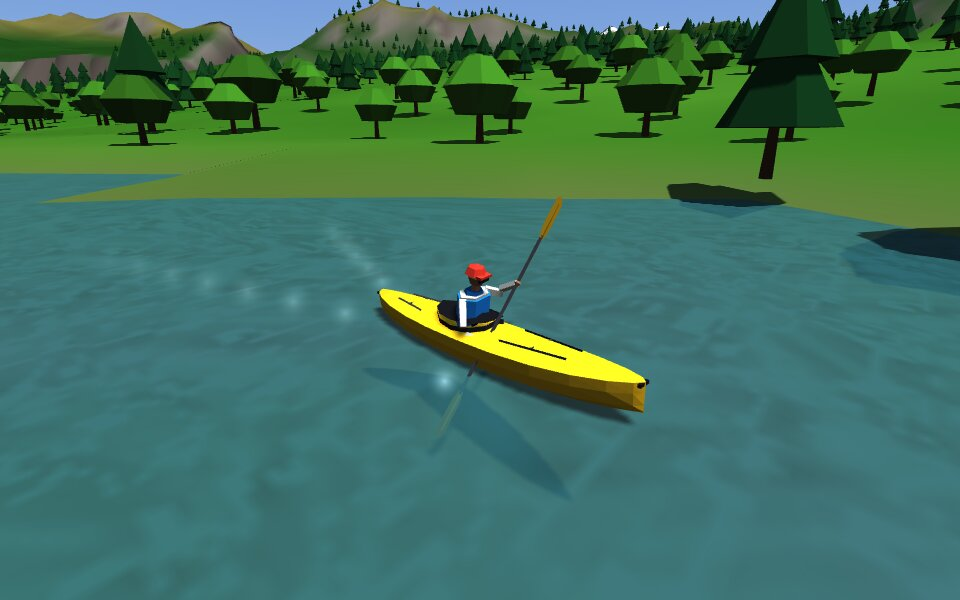 |
| **Canoe** | 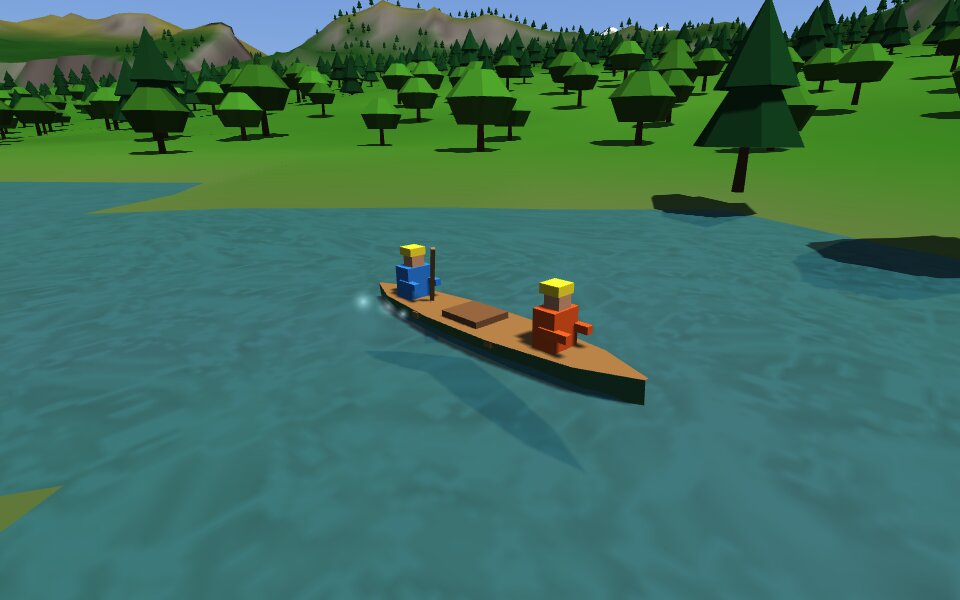 | 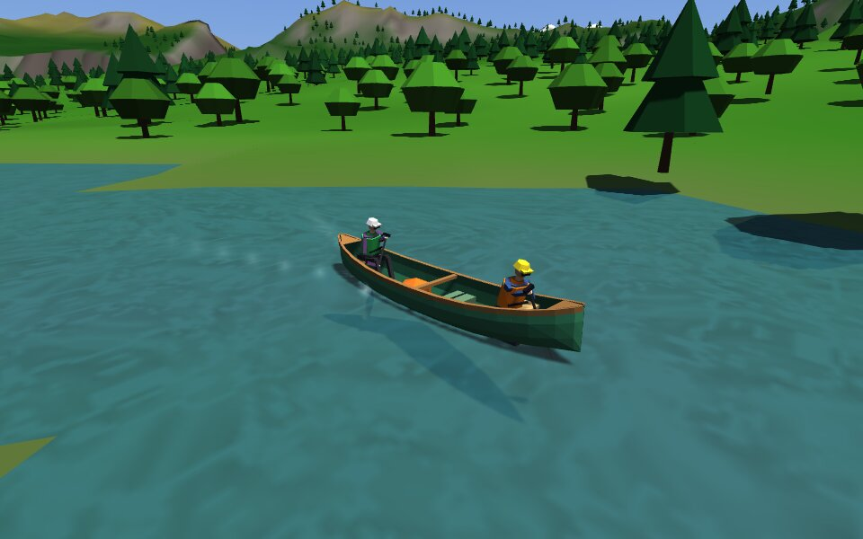 |
| **Dory** | 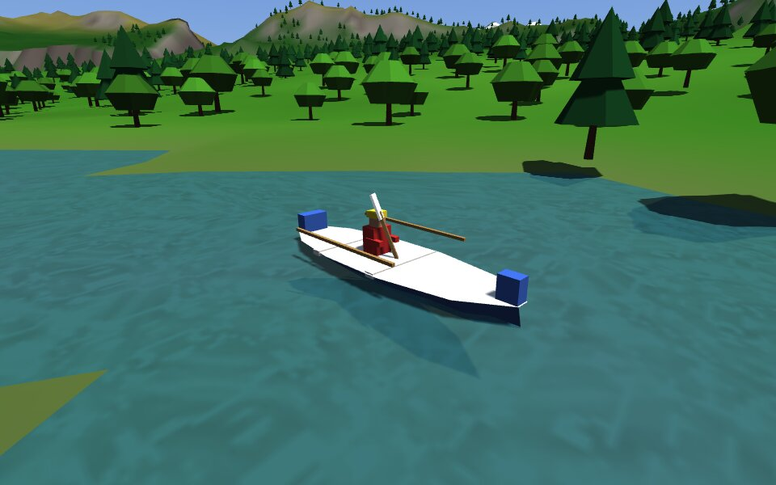 | 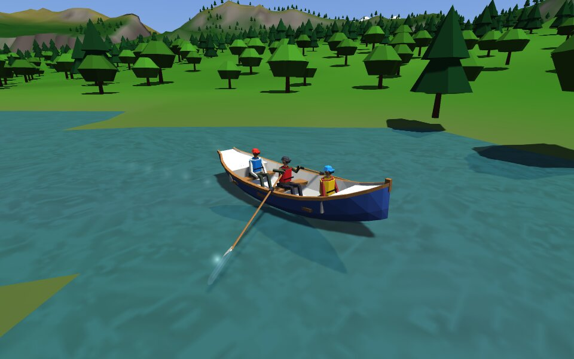 |
| **Raft in a rapid** | 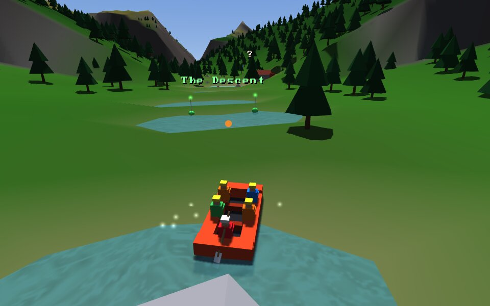 | 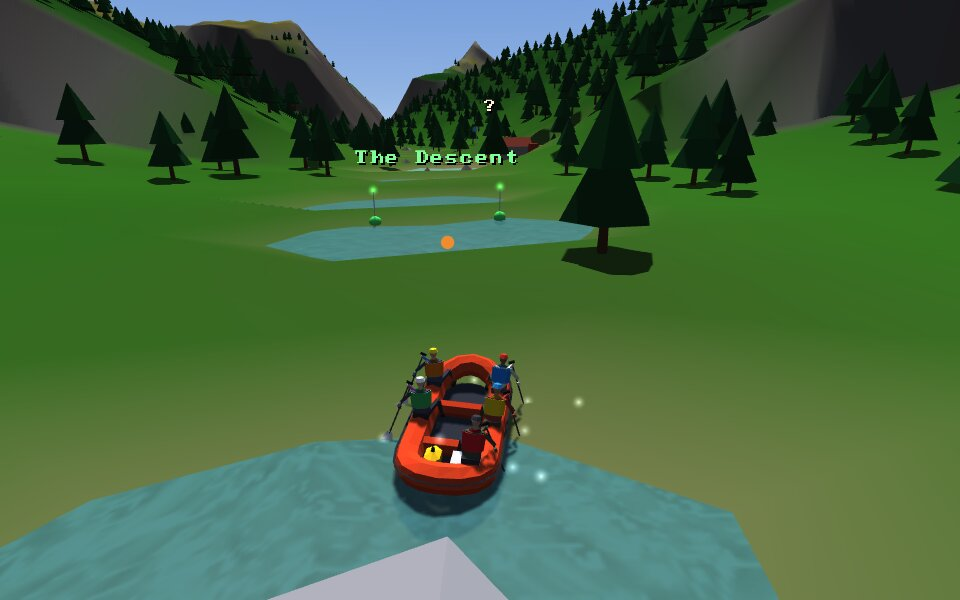 |
| **Kayak in a rapid** | 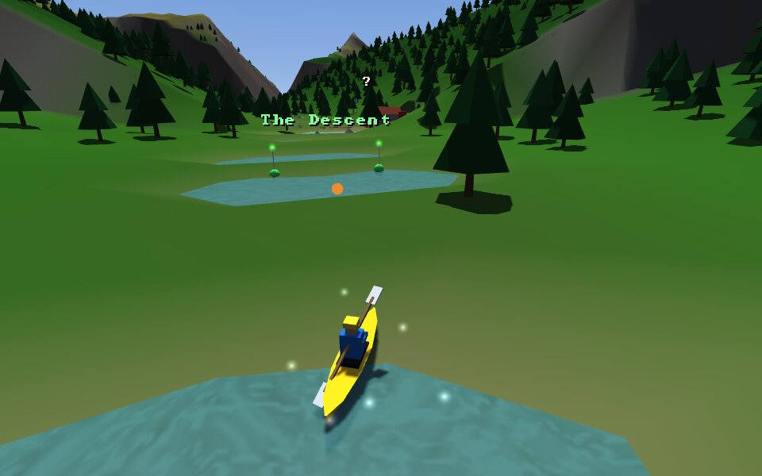 | 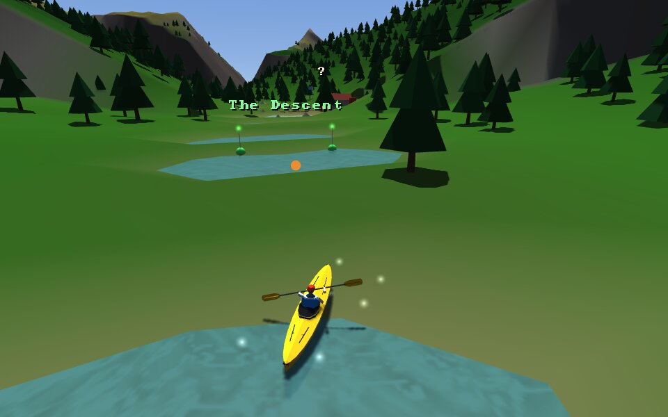 |

| | |
|---|---|
| 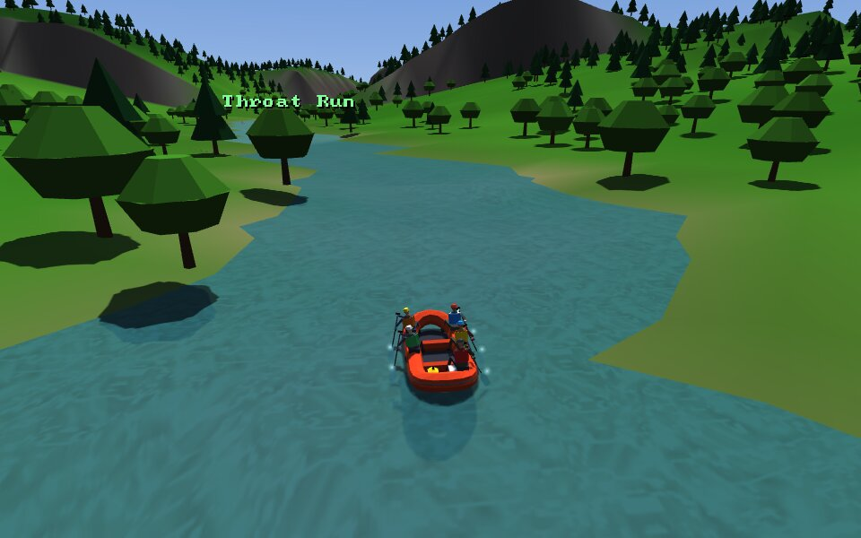 | 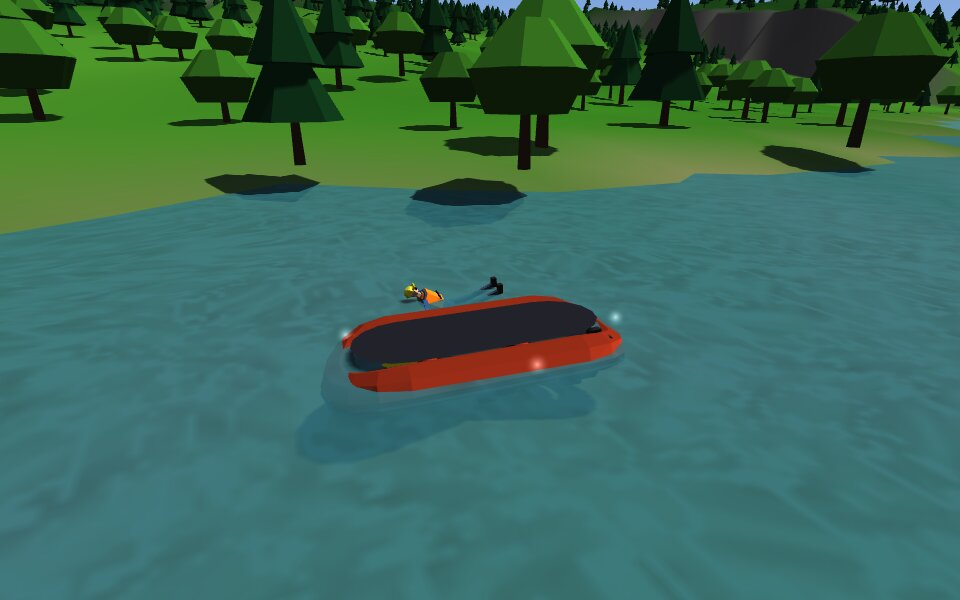 |
| **Leaning into a left turn.** | **A swim.** |
| 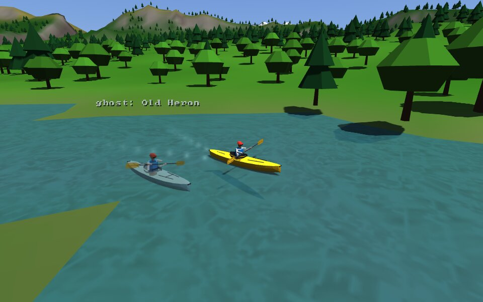 | |
| **A ghost** is the same boat, pale and translucent. | |
