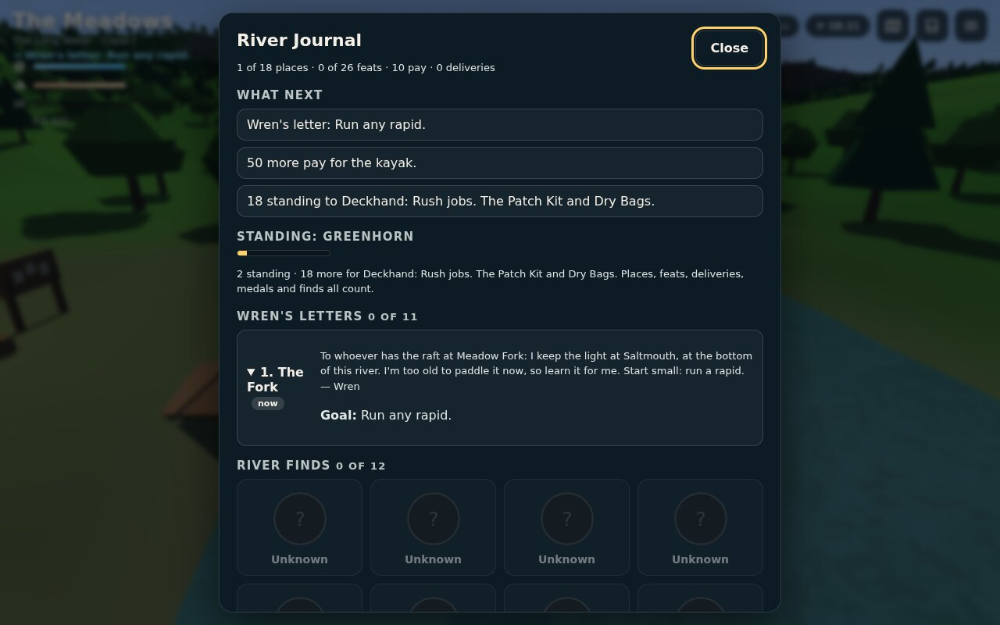
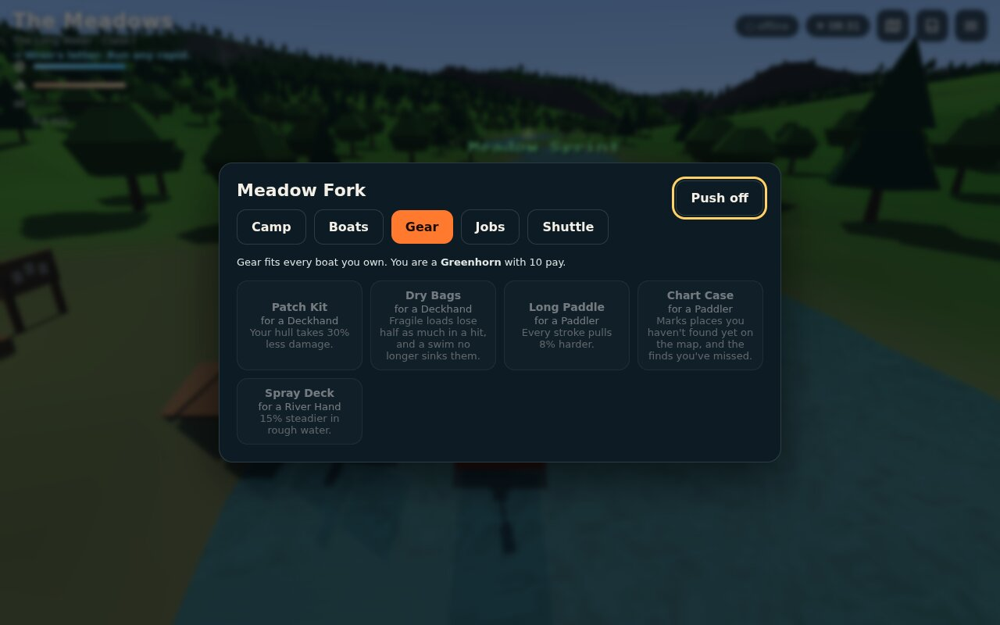
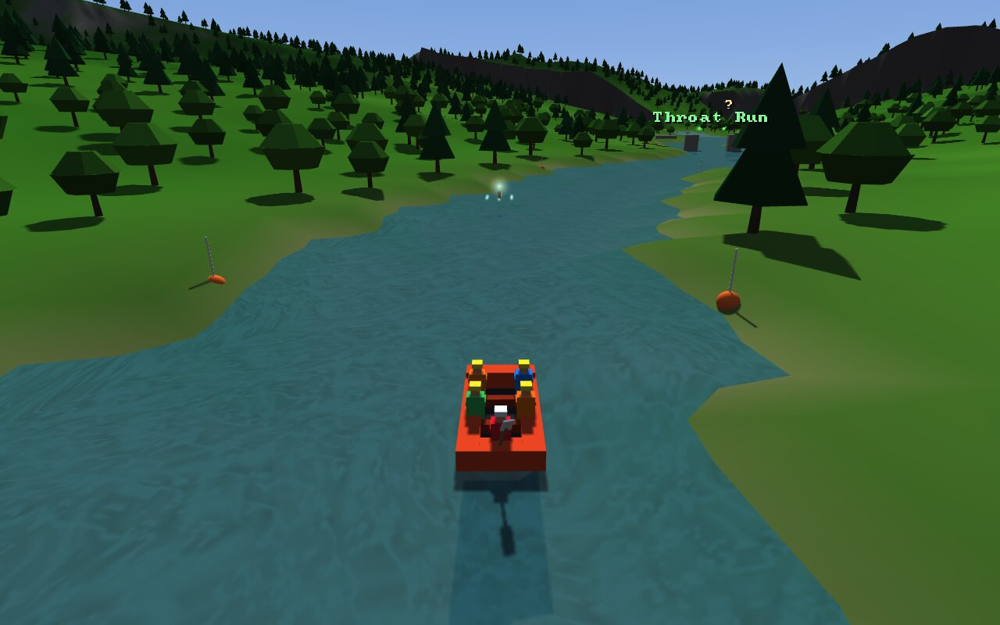
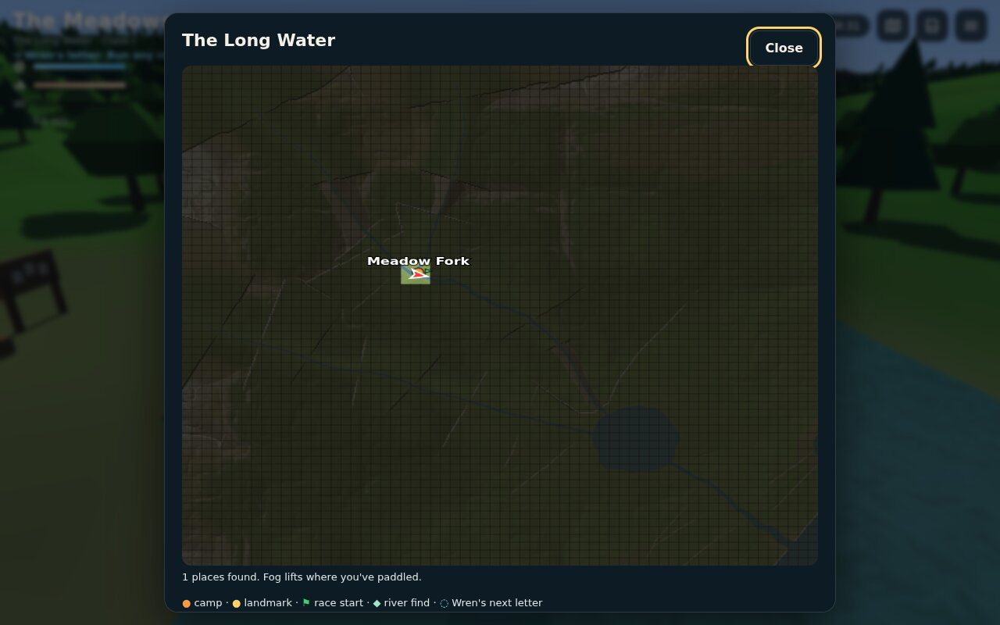
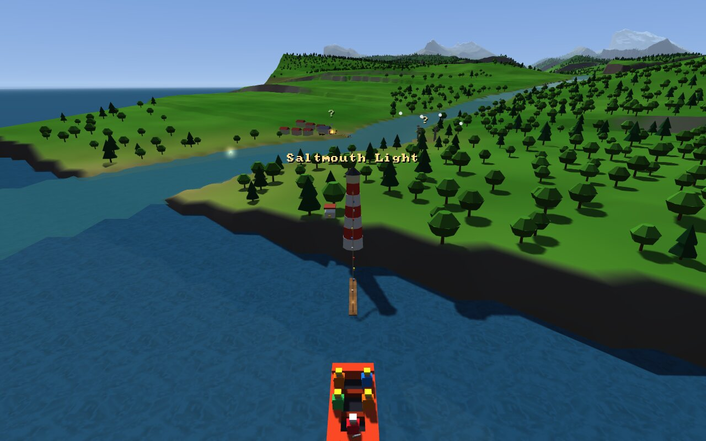
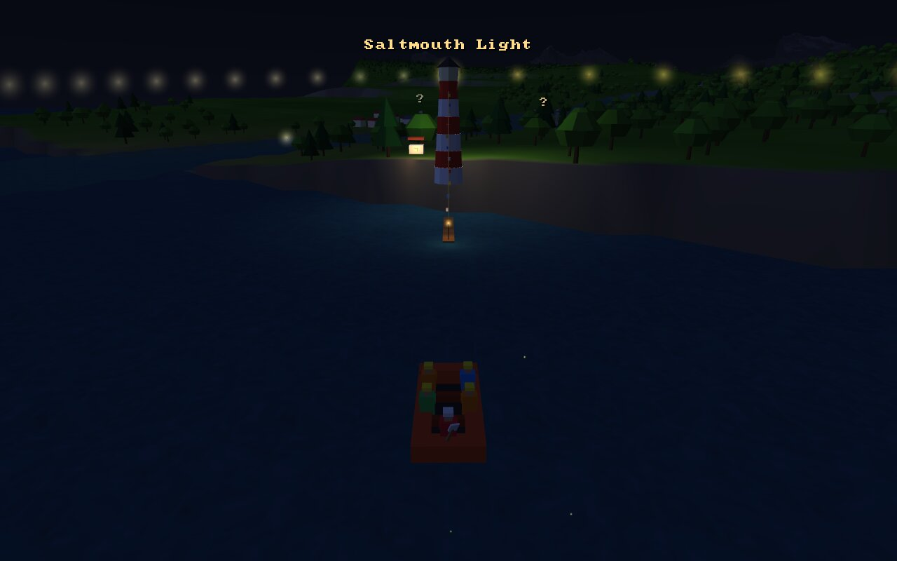
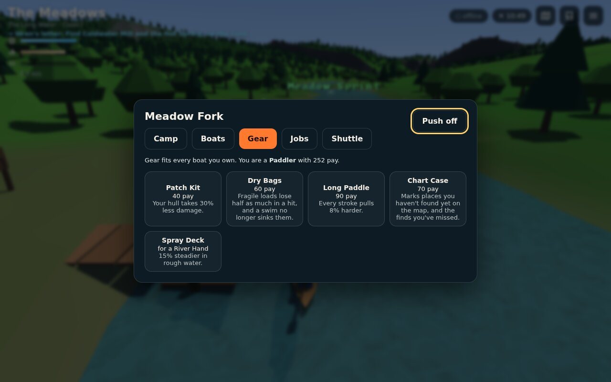
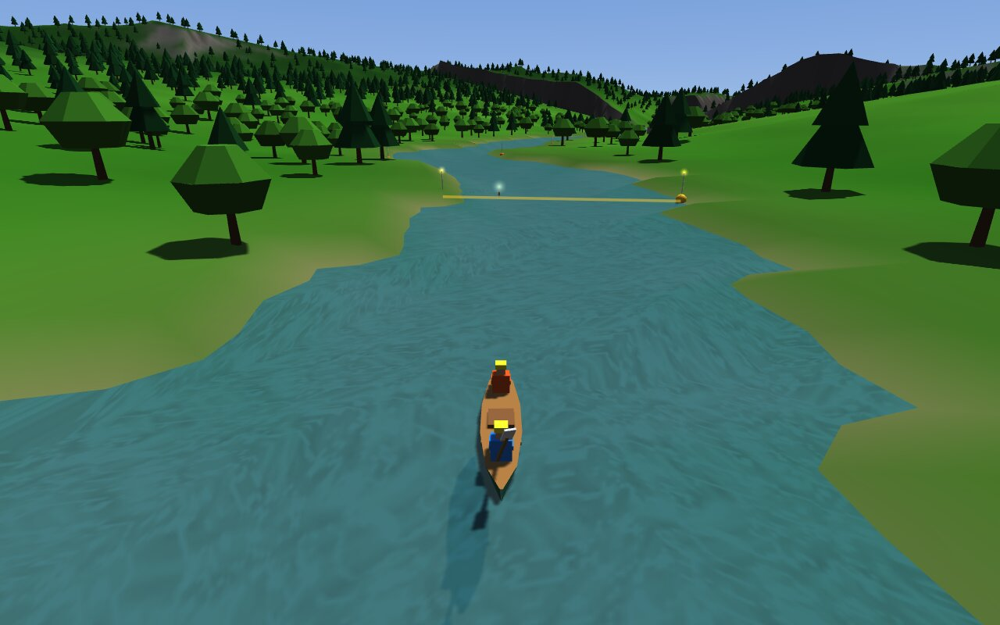
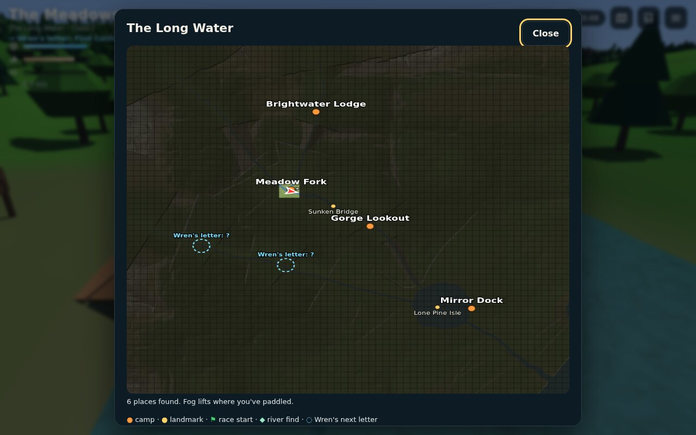

# Content and progression playtest (0.2.0)

Lane: content and progression, 0.2.0 polish pass.

Two kinds of evidence:

- **Headless sessions** (`pacing.mjs` here): a model player runs 30 minutes
  of play against the game's real job boards, journal, progress and places in
  node. Travel is modelled (distance over boat speed, slow upstream, the
  shuttle when the way is upstream and the camp is known); rapids, swims and
  medals are rolled. Two policies: *worker* (always takes the best-paying job)
  and *explorer* (follows "what next", a job every other camp).
- **Browser rounds** (`r1/`, `r2/`): the real game, `?server=off&world=small`,
  driven frame by frame in headless Chromium with a 0.1.0-shaped save in
  localStorage: the HUD goal line, journal, map, camp tabs and a river find.

```sh
node docs/playtests/0.2.0/content/pacing.mjs --old            # 0.1.0 rules
node docs/playtests/0.2.0/content/pacing.mjs                  # this branch, worker
node docs/playtests/0.2.0/content/pacing.mjs --explorer       # this branch, explorer
```

## Round 1 (0.1.0 rules, then the first cut of progression)

What a 0.1.0 player does in 30 minutes (worker, seeds 1–3):

| | seed 1 | seed 2 | seed 3 |
|---|---|---|---|
| pay left over | 523 | 560 | 637 |
| all boats bought by | 25:33 | 15:44 | 15:44 |
| milestones (finds, feats, buys) | 18 | 18 | 17 |
| longest gap with nothing new | 9:15 | 6:26 | 8:35 |

Findings:

1. **Pay runs out of uses at ~15 minutes.** The dory (180) is the last thing
   to buy; after that pay piles up with no use. There is no reason to take
   the next job except the job itself.
2. **Undeliverable jobs.** Meadow Fork's board offered rope coils to Tarn Hut
   (110 pay, the best on the board) to a player who had never been there. Tarn
   Hut is above the sixteen-metre High Falls: you can't paddle up, and the
   shuttle only goes to camps you've found. The first cut of the model player
   took it and spent the first twenty minutes slogging upstream (one
   discovery in 15 minutes). A real player takes it, can't get there, and is
   stuck until they think of "Leave it".
3. **The shuttle prints money.** An upstream load pays ×1.8 for "the hard
   way", but the shuttle carries it there in no real time at all (three game
   hours, inside every deadline). Ferry Landing → Coldwater Mill by truck for
   185, then back down by river for 105, repeated.
4. **No "what next".** Nothing in the game tells you where to go after the
   first camp. The title says "push off downstream, or paddle up to the
   Brightwater", and then you're on your own.
5. **Stacked cards.** A rapid that earns First Rapid, a letter and a rank
   together drew three cards in the same spot at once.
6. **`dayCount` isn't saved.** Every reload starts on day 0, so the boards
   repeat and an active job's deadline (`dueClock`, measured in days)
   is wrong after a reload on day 2+.

Fixes (all in this branch):

- A progression arc: **standing** (from places, feats, deliveries, medals and
  finds; computed, never saved) and six **ranks** that open rush jobs,
  passengers, surveys, a fourth job on every board, +15% pay, and five pieces
  of **gear** (380 pay in all, rank-gated). **Wren's letters**, eleven
  regional goals with a light story, pull you round the valley.
  **River finds** (twelve keepsakes and Abel's bottled letters) glint in calm
  water. The **"what next" line** under the place name always has something.
- Boards never send you upstream to a camp you haven't found. Wren's current
  letter tells the shuttle driver to expect you (Tarn Hut, above the falls,
  is reachable for "The Top of the World").
- The shuttle takes half the pay of a job you haul with it, and a shuttled
  load doesn't count for Against the Current.
- Cards queue (one every 4.5 s; past a 14 s backlog they become toasts).
- `day` is saved.

## Round 2 (after the fixes)

Worker, 30 minutes:

| | seed 1 | seed 2 | seed 3 |
|---|---|---|---|
| pay left over | 215 | 242 | 269 |
| last purchase | 24:34 | 25:32 | 26:12 |
| milestones | 26 | 28 | 27 |
| longest gap | 6:37 | 5:10 | 6:58 |
| rank at 30 min | Paddler | Paddler | Paddler |

Explorer, 30 minutes (seeds 1 / 2 / 3): 9 places, 5 of Wren's 11 letters,
2 finds, Paddler, 31 / 34 / 33 milestones (0.1.0 explorer: 16 milestones,
longest gap 9:48). Seed 3's explorer still has a 12-minute gap: Brightwater
Lodge to Mirror Dock, back down water it has already explored. Ranks space out as intended: Deckhand at ~6–13 min, Paddler at
~14–16 min, River Hand not reached in 30 (35–45 min), Guide and River Master
are for players who come back.

Remaining notes:

- The worker policy only ever finishes two letters: jobs always win. The HUD
  "what next" line puts the job first while one is active and the letter
  second; that's deliberate (you finish what you took), but a player who
  chains jobs forever will only see letters in the journal.
- The longest gaps left are long single trips (Mirror Dock to Lone Pine Isle
  via a delivery). Finds sit along those stretches to break them up.
- Gear is bought by ~25 minutes; the Spray Deck waits on River Hand.
  Pay then piles up again, more slowly; a later pass could add a sink
  (boat repaints or a second rack slot) if that turns out to matter.

## Browser rounds

Both runs use the real game in headless Chromium (`?server=off&world=small&skip=1&drive=1`).
`result.json` in each folder holds the panels' text and the save after the
run. Page screenshots often time out under swiftshader with other lanes on
the box, so the text dumps are the main evidence; the stills that came
through are in the folders.

**r1: a 0.1.0 save** (canoe, 6 places, 3 feats, 137 pay, 6 deliveries, a
silver on Meadow Sprint, no `day`, no `progress`):

- Loads with no errors. One toast: "Your journal caught up: 5 of Wren's
  letters…", no card flood; pay 137 → 252 (the five letters' rewards); rank
  Paddler at once.
- The HUD goal line reads "→ Wren's letter: Find Coldwater Mill and the Hot
  Spring…". The map rings both targets as "Wren's letter: ?"; the shuttle tab
  offers Coldwater Mill with a "Wren's letter" tag (`03-map.jpg`).
- Gear tab (`04-camp-gear.jpg`): four items for sale, the Spray Deck "for a
  River Hand". Buying the Patch Kit took 40 pay; it was in the save.
- Paddling over the paddle-blade find picked it up (+10 pay, card).
- Problems found: the find's glint was tiny and sat right on the Meadow
  Sprint start buoys (`05-find-ahead.jpg`); "Spray Deck.. Places" in the
  journal; "and 0 new feats" in the catch-up toast; locked gear didn't look
  locked.

Fixed for r2: a bigger glint plus a ring of ripples, and the bottle is
larger; the blade moved 200 m down from the start buoys; the text; locked
gear tiles get the journal's `locked` style. Wren's first letter now arrives
as a card a few seconds into a new game (r2 showed a new player got only the
HUD line).

**r2: a new game** (`&new=1`):

- Meadow Fork's board: three deliveries, all reachable (Gorge Lookout,
  Coldwater Mill, Mirror Dock); no Tarn Hut.
- "What next": the first letter, "50 more pay for the kayak", "18 standing
  to Deckhand". Gear tab is all locked for a Greenhorn; shuttle says to find
  camps first.
- The find is visible from 40 m (`r2/05-find-ahead.jpg`: glint and ripples
  mid-river), picked up, saved (`progress.finds: ["blade"]`).


## Wave 2 (the top open findings)

Asked for: letters starve under the best-job player; pay piles up once the
gear is bought; revisiting explored water is slow; check gear on top of the
feel lane's boat retune.

What changed:

- **Wren's errands.** Every board carries a parcel for Wren's next stop (the
  nearest unfound target of her current letter, a camp first), at a bit
  better than delivery pay. A camp on the letter can be any distance: the
  shuttle takes you and Wren pays the driver (no half-pay cut). Landmarks
  far upstream, Tarn, the Spring, the Throat and the Falls never get errands.
- **Boards hand out each job once.** Taken jobs leave the board for the
  day (`jobs.taken`, saved, optional). The model player found the hole: it
  shuttled back to Mirror Dock and took the same 190-pay fiddle to Meadow
  Fork four times in ten minutes.
- **The goal line takes turns.** With a job on, Wren's letter shows for 10 s
  in every 30.
- **Shuttle hint.** When Wren's next stop is over 900 m away and a camp you
  can shuttle to is less than half as far from it, the letter's goal says so
  ("The shuttle to Gorge Lookout saves the paddle."). That's the cheap fix
  for slow revisits: shuttling between known camps is already instant in
  real time; players just weren't told. (A "fair current" boost on known
  water would be a physics change in the feel lane's files.)
- **Saltmouth Light.** Four stages funded from any camp's Gear tab once
  Wren has written twice: the Keeper's Dock (100), Signal Flags (120), the
  Keeper's Cottage (200), A New Lens (250). Each is drawn at the light;
  the lens is a long gold night beam visible from far up the river. A
  Lightkeeper feat for all four. `progress.light` defaults to 0.
- **Gear on the feel retune.** The feel lane's `boat.js` diff (read only)
  doesn't change any BOATS numbers: it flips the turn strokes' sign and adds
  a "line" that steers round rocks using `spec.beam` and `spec.turn`, which
  gear never touches. Gear now has caps anyway (stroke ≤ 1.7, stability ≤
  1.4; only the dory's 1.44 is clipped), and top speed is untouched, so the
  Long Paddle gets you to speed about 7% sooner, never faster. Tests check
  every boat and a 20 s paddle on the lake.

The model also got two fixes: the High Falls height (it thought the Hot
Spring was above the falls) and wave-2 player habits (hop by shuttle when
the hint says so; fund the light after the gear).

### Before and after, 30 minutes

| | 0.1.0 | wave 1 | wave 2 |
|---|---|---|---|
| worker: Wren's letters | – | 2 / 11 | **6 / 11** |
| explorer: Wren's letters | – | 5 / 11 | **7 / 11** |
| worker: pay left at 30 min | 520–640 | 205–270 | 170–280 (light stages 2–3 of 4 bought) |
| worker: milestones | 17–18 | 25–28 | 38–41 |
| worker: longest gap | 6–9 min | 5–7 min | 9 min (the Mill → Hot Spring paddle upstream) |
| places found (worker) | 6 | 6–7 | 9 |

At 60 minutes the explorer has 8 letters, River Hand, all gear and three
light stages; the 0.1.0 player has 1200 pay and nothing to spend it on.

Left open: the slowest leg is now the Coldwater upstream from the mill to the
Hot Spring (about 9 minutes in the model at 1.3 m/s). It's a short river
distance but slow water; the model may be pessimistic about upstream speed.

### Browser round 3 (`r3/`, `play3.cjs`)

A new game with the first three letters claimed, in the real game:

- Meadow Fork's board leads with "Wren's errand: a parcel for Gorge Lookout
  · 637 m · 7 hours · 95 pay", above three deliveries (`r3/result.json`).
- With the errand taken, the goal line showed the job at 5, 10 and 15 s and
  "Wren's letter: Find Gorge Lookout…" at 20 and 25 s (`r3/result-goal-line.json`).
  The full 8-sample loop ran past the 900 s budget under swiftshader, so the
  re-run skips it.
- Funding the light four times from the Gear tab took it 1 → 4.
- Stills off Saltmouth (`07-light-day.jpg`, `08-light-night.jpg`): the dock
  runs out from the tower's foot with its lantern lit at night; the
  pennant line runs from the lamp to the end of the dock; the cottage
  stands inland with a lit window; the lens's gold beam sweeps a long
  arc at night. The first try put the cottage over the cliff edge and the
  pennants behind the tower; both moved, and the cottage and pennants were
  made larger after the second still (not re-shot).

## Screenshots

| | |
|---|---|
|  |  |
| **The journal: What next, Standing, Wren's letters, River finds.** | **The Gear tab at a camp.** |
|  |  |
| **A river find glinting ahead.** | **The map after a run.** |
|  |  |
| **Saltmouth Light, restored, by day.** | **Saltmouth Light, restored, at night.** |
|  |  |
| **Round 1: the Gear tab.** | **Round 1: a find ahead.** |
|  | |
| **Round 1: the map.** | |
