# Feel & controls playtest (0.2.0)

Lane: feel and controls (paddling, steering, camera, input, rhythm, first five
minutes). World `small`, seed 1, `?server=off`. Headless Chromium (SwiftShader)
driven by script: keys and pad buttons pressed over time, the game's own frame
stepped at 30 fps, stills from the canvas plus a page screenshot for the HUD.

There were two kinds of round:

- **Simulation rounds** (Node, no GPU): the boat, the guide and a bot that
  answers calls perfectly, early, sloppily (±0.25 s at random) or not at all,
  run through named rapids from the spawn. These found the biggest problems.
- **Browser rounds** (`r2` keyboard, `r3` phone portrait with touch): the
  first minutes of a new player with the coach, driven through the real input
  paths.

## Round 1: simulation, before changes

| Finding | Evidence |
|---|---|
| **The rapids had no rhythm.** Gorge Gate (class III, 320 m) gave 10 calls in over three minutes, 16 to 25 s apart. The BPM set the grid but nothing filled it. | Bot run from 40 m above Gorge Gate: call gaps `25.4, 18.5, 16.2, 20, 23.9, 16.9…` s |
| **Following a rock call steered into the rock.** A rock on river-right is called *Left!*, which is correct, but a left stroke grew the heading. Round r2 showed that a growing heading turns the bow screen-right. The physics hid it, because a judged hit ghosts the rock. | `rock.mjs`: the called stroke and the opposite one hit the rock equally often (54/60 each). Root cause confirmed in r2. |
| **A clean line was not visible.** A judged stroke cleared the rock, and the boat then sailed *through* it. Only 4 of 60 rocks were passed with the hull clear. | `rock.mjs` with rocks ghosted: mean pass distance −0.41 m |
| **A rapid ran once per session.** `f.called`/`f.cleared` were never reset, so after a shuttle or a second visit the rapid stayed silent and its rocks stayed ghosted. | code read and a test (`running a rapid again calls it again`) |
| An early stroke was labelled **Late**. | `judge()` used one label for both sides of the window |
| At class V the windows overlap (0.55 s beats, ±0.3 s). A stroke meant for the *next* call landed **Wrong way** on the one before. | test `overlapping windows…` |
| The camera **snapped** from heading to travel direction at 1.2 m/s, and in rapids it followed a boat spinning off rocks. | code read; `camera: … no snap` test |
| The phone path had **no signals** (wave/flare/bell were keys 1/2/3 only), no run on foot (Shift only), and no walking hint on touch. | code read |
| No first goal: the title card closes onto a river with nothing pointing anywhere. | r1 title still |

## Changes (see the lane report for files)

- Drive calls: *Forward!* on the beat between features (every 4/3/2/2 beats
  for class II/III/IV/V). A dropped drive call costs some flow, not stability
  or the clean line. Steering between them is free.
- Left strokes turn left. The stroke yaw signs and the walker's right vector
  were mirrored, so `A` turned right and `D` walked left (r2). A clean stroke
  on a rock call now follows a short line round the rock (`dodge`), so the
  clean line can be seen.
- Rapids re-arm on entry.
- Early and late are labelled separately. With overlapping windows, a stroke
  goes to the call it matches.
- The coach: stroke, steer, ride to the next place downstream, run the first
  rapid (with timing windows 1.4× wider, once), go ashore. After that, a hint
  with an arrow when the river goes quiet.
- Camera: a smooth heading-to-travel blend, and framing in rapids that looks
  downstream, higher and further ahead.
- Touch: a signals button (wave, flare, bell), hold ▲ to run on foot, a
  walking hint, and haptics per judgment. Gamepad: D-pad, a deadzone, the
  right stick orbits the camera.
- The gate pulses on the beat.

## Round 2: simulation, after changes

| | Before | After |
|---|---|---|
| Gorge Gate call gaps (s) | 16–25 | 2.31 (3 beats), with 0.77 when a feature follows a drive call |
| Calls in Gorge Gate, perfect bot | 10 | 65 (11 feature + 54 drive) |
| Rocks passed with the hull clear after a clean call | 4/60 | 53/60 |
| Sloppy bot (±0.25 s) | n/a | 0 misses: 15 perfect, 39 good, 10 early. No flips. |
| No input | 9 misses, 2 flips | same (drive calls do not punish the boat) |

## Browser round r2: keyboard, new player, coach on

Stills: `r2/`. Log: `r2/log.txt`. Drivers: `scripts/` (`drive.cjs <scenario> <outdir> [w h touch]`, the Node sims `run.mjs` and `rock.mjs`).

- **The steering was mirrored (fixed).** After holding `A` for 1.3 s the
  raft's bow had swung to the screen's *right* (`r2-01` → `r2-02`).
  `kit.project` agrees: a point at `heading + 0.5` projects right of the bow
  (886 px vs 779 px), and the walker's "right" vector `(-sin yaw, cos yaw)`
  projects *left* of the boat (366 px vs 621 px). Strata's view is
  right-handed, so screen-right is `(sin yaw, -cos yaw)`. In 0.1.0, `A`/`←`/◀
  turned the boat right and `D` walked left. The fix is at the source: the
  stroke yaw signs in `sim/boat.js` and the walker's right vector. The rock
  calls were already right ("rock on river-right: steer left"); only the
  turn was backwards. I had flipped them earlier in the day, and reverted that.
  - Not fixed (engine): `strata-kit.js` uses the same mirrored screen-right
    for two-finger/right-drag **panning** (`sx = -sin, sz = cos`, line ~209),
    so panning probably moves the wrong way too. That belongs to the engine
    lane.
- **The prompt sat on top of the boat** (`r2-01`: "Meadow Fork · E go
  ashore" over the raft). Fixed: the prompt sits low and only rises above
  the lane in a rapid.
- **The lane covered the boat in a rapid** (`r2-03`, `r2-04`). Fixed: on
  desktop the lane sits at the bottom edge. In rapids the camera aims closer
  to the boat (1.5 m ahead instead of 8), so the boat sits mid-screen, and
  rises (pitch +0.12) and pulls back (+3 m) to show the water ahead.
- **Markers drew past the end of the lane** (`r2-03`, right edge). Calls
  queued further out than `LEAD` now fade in at the lane's end.
- The coach worked through paddle → turn → explore ("Ride the current
  downstream to Sunken Bridge · 310 m", arrow) → the rapid tip → the ashore
  step. The pilot rode past Gorge Lookout mid-river without ever coming
  within the camp's 28 m, and ended on Mirror Lake. There the coach pointed
  on to Ferry Landing, 620 m, which is right: it targets the next camp
  downstream.
- **Rapids are slow (open, world lane).** Gorge Gate (class III, 320 m) took
  the early-bot over two minutes, with the boat at 1–2.5 m/s. `flowSpeed`
  gives class II 1.7 m/s and class III 2.5 m/s before the width factor, and
  in a rapid strokes come only on calls. The drive calls make the time
  eventful, but a class III should probably run at 3–4 m/s, or the named
  rapids should be shorter. Changing `flowSpeed` moves race medal times and
  ghost plausibility checks, so I left it for the world/content lane.

## Browser round r3: phone, portrait 390×844, touch

Stills: `r3/`. Driven only through the pad's own buttons (pointer events) and
the on-screen prompts.

- Works: the pad shows on touch. The coach uses phone wording ("Tap ▲",
  "◀ ▶ turn the bow"). Holding ▲ keeps paddling (3.2 m/s after 2.5 s). ◀ now
  turns left (heading 12° → −33°). The signals fan opens, and closes after a
  wave. *Go ashore* works from the prompt. Holding ▲ on foot breaks into a
  run (`input.shift` true after 0.9 s). ▶ walks right on screen (projected x
  −122 → 216).
- **The signals button overflowed the bottom row** (`r3-02`): five buttons
  in 390 px pushed ▲ off the right edge, and the open fan sat on the *Go
  ashore* prompt. Fixed: the button sits above ◀, and its fan opens upward.
- **The coach banner was 195 px wide** (shrink-to-fit with `left: 50%`), so
  one line wrapped to four. Fixed with `width: max-content` under the
  existing max-width.
- The place subtitle ("The Long Water · Class I") wrapped into the meters.
  Fixed: it is cut off with an ellipsis on phones.
- **Ashore, the camera ended up inside the shuttle truck** (`r3-05`: a dark
  wall). Fixed: the walker's camera marches from the walker toward the eye
  and pulls in short of trees and the camp's solid things.
- Open (world/content lane): in the small world, Gorge Lookout (*"Last flat
  water before the gorge"*) sits inside Gorge Gate's range (camp s≈2022,
  rapid 1824–2145). The lane and the coach's rapid tip stay up while you are
  at the camp.

## Browser round r4: keyboard, checking the fixes

Stills: `r4/`.

- Steering: the bow point's screen x went 640 → 530 after holding `A`, then
  → 760 after `D`. **Left turns left.** On foot, `D` moved the walker right
  on screen (384 → 660 px).
- In Gorge Gate the boat sits mid-screen with the lane under it along the
  bottom edge (`r4-03`, `r4-04`). The camera looks down the river past a boat
  that hugs the left bank. The race prompt sits above the lane, clear of the
  boat.
- At a camp the prompt sits low and clear of the boat (`r4-05`).
- Found, then fixed: the coach's rapid tip stayed up through 25 s of perfect
  strokes, because drive calls were not counted as hits. They count now.

## Browser round r5: phone layout after the fixes (portrait and landscape)

Stills: `r5/` (390×844), `r5l/` (844×390).

- Portrait: every pad button fits (▲ spans 278–374 px of 390). The signals
  button sits above ◀ and its fan opens upward. The coach banner is one line.
  The camp prompt reads **"Meadow Fork" + [Go ashore]** with no dangling
  "·" (owner's bug, fixed in `places.js`: touch drops the separator and the
  prompt lays out as a wrapping row). Ashore, the touch walking hint shows,
  and the camera holds 7.5 m with nothing in the way.
- Landscape (`r5l`): the open fan covered the meters, the prompt sat on the
  boat, and the lane would have crossed the boat in a rapid. Fixed for short
  viewports: the fan opens sideways, the prompt moves up under the coach,
  and the lane drops between the two button clusters. See r6.

## Browser rounds r6–r7: landscape and the final phone prompt

- r6 (844×390): the signals fan opens in a row above ◀, clear of the meters.
  The prompt sits under the coach, off the boat. In Gorge Gate the lane runs
  between the two button clusters, with the boat clear above it.
- r7 (390×844): the camp prompt reads "Meadow Fork" over [Go ashore] (text
  `Meadow Fork Go ashore`), with no separator.

## Still open

- Rapids are slow (class II–III current 1.5–2.5 m/s, so a 320 m rapid takes
  2–3 min). This is world/content: `flowSpeed` or the rapid lengths.
- ~~Gorge Lookout sits inside Gorge Gate's range~~: fixed in wave 2 (see below).
- ~~`strata-kit.js` pan direction mirrored~~: fixed locally in wave 2, to be reported upstream.
- ~~A missed rock charged twice~~: fixed in wave 2.
- Not checked on a real phone: haptics (`navigator.vibrate`), and `:has()`
  support on older iOS Safari (15.4+ is needed for the pad-aware layout;
  without it the old positions apply).

## Wave 2 (open findings)

- **One rock, one penalty.** A missed rock call used to charge the miss
  (*Hit the rock!*) and then the collision (*Rock!*) as well. Now
  `Caller.rockHit` / `missPenalty` charge each rock once. If the boat reaches
  a rock while its call is still pending, the call counts as missed and is
  charged once. A rock whose miss was already charged bounces the boat but
  costs nothing more. A rock nobody called costs a knock by impact speed,
  once. Re-arming a rapid resets this.
- **Panning.** `web/engine/strata-kit.js` (vendored Strata web kit) panned
  against the finger, because it used the same mirrored screen-right. Fixed
  locally in `kit.pan` with a comment. To report upstream to Strata.
- **Gorge Lookout** moved from `f: 0.5` to `f: 0.44`. That puts it in the
  flat water 45 m above Gorge Gate, as its card says ("Last flat water
  before the gorge. Scout it from here."), where before it stood inside
  Gorge Gate (s 2022, rapid 1824–2145). Courses are defined by their own
  `f0`/`f1`, so no gate moves; the full suite (courses, dry land) passes.
  The coach now suggests going ashore at a camp the player passes (not the
  spawn camp). After the first rapid it ends rather than sending a new
  player 1.3 km on through the Throat to the next camp.
- **Content's gear** (`gearedSpec`: stroke ×1.08, stability ×1.15, capped;
  read from the content worktree without editing it): it changes neither
  `turn`, `beam` nor `mass`. The steering sign and the rock line are
  identical with gear and without it, on all four boats. A left stroke
  changes the heading by −0.254 (raft), −0.394 (kayak), −0.229 (canoe) and
  −0.216 (dory) both ways. The line clears 38/40, 40/40, 40/40 and 39/40
  rocks both ways.
- **Browser round r8** (`r8/`): with `kit.pan(100, 0)` the camera target's
  screen x went 640 → 713, so the scene follows the finger. Piloting down
  from Meadow Fork, the boat reaches Gorge Lookout in class I water with no
  rapid active. The prompt reads "Gorge Lookout · E go ashore", and the coach
  says "You're at Gorge Lookout. Press E to go ashore and look around." with
  an arrow to the camp (30 m).

## Screenshots

| | |
|---|---|
| 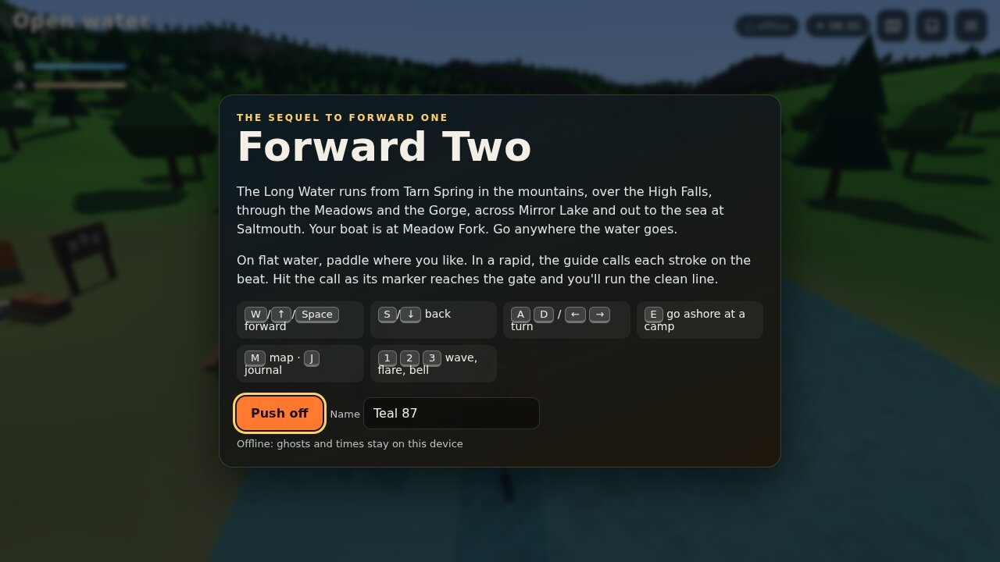 | 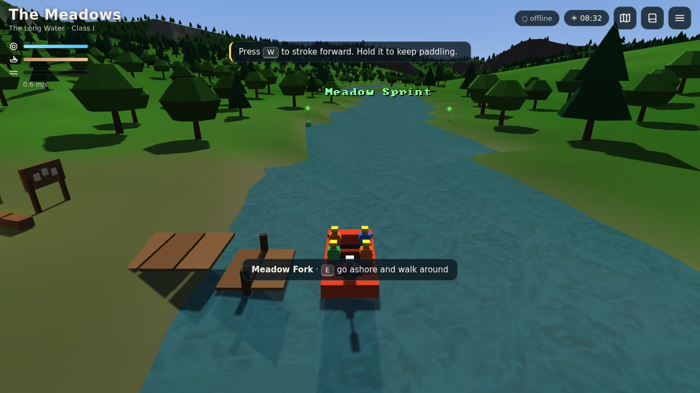 |
| **Title card with the controls.** | **The coach: paddle.** |
| 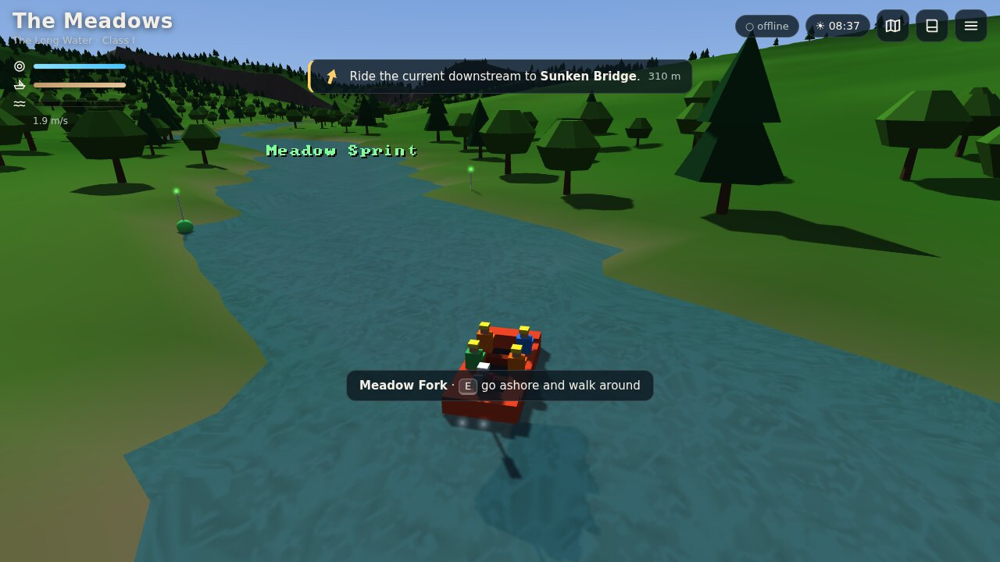 | 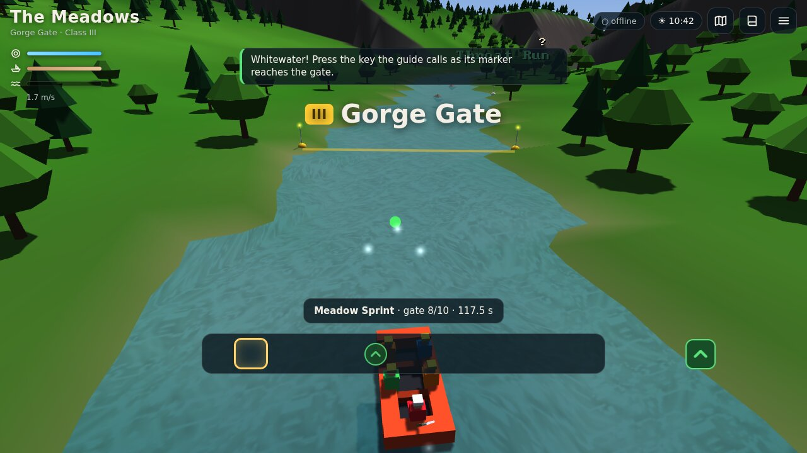 |
| **The coach: head downstream.** | **The first rapid, on the guide's calls.** |
| 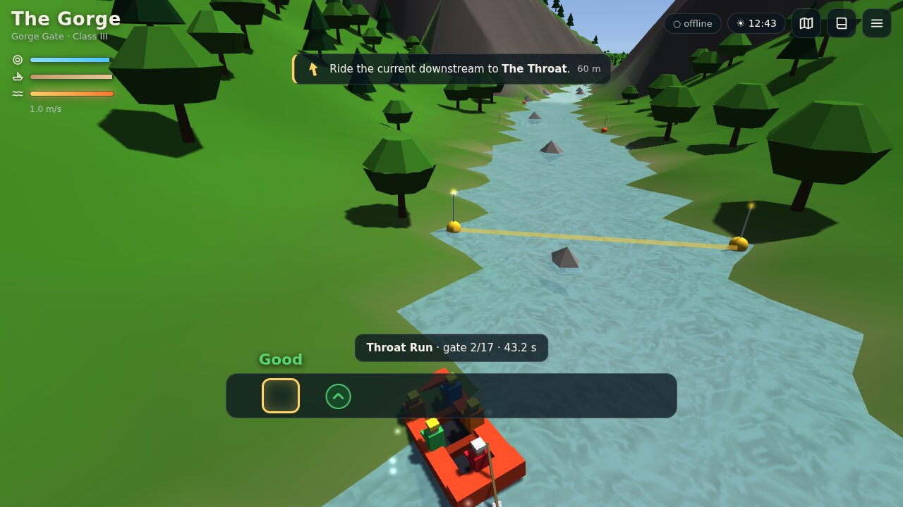 | 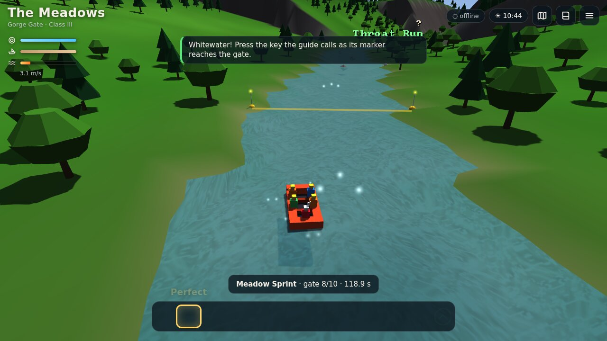 |
| **After the first rapid.** | **A rapid: the call lane.** |
| 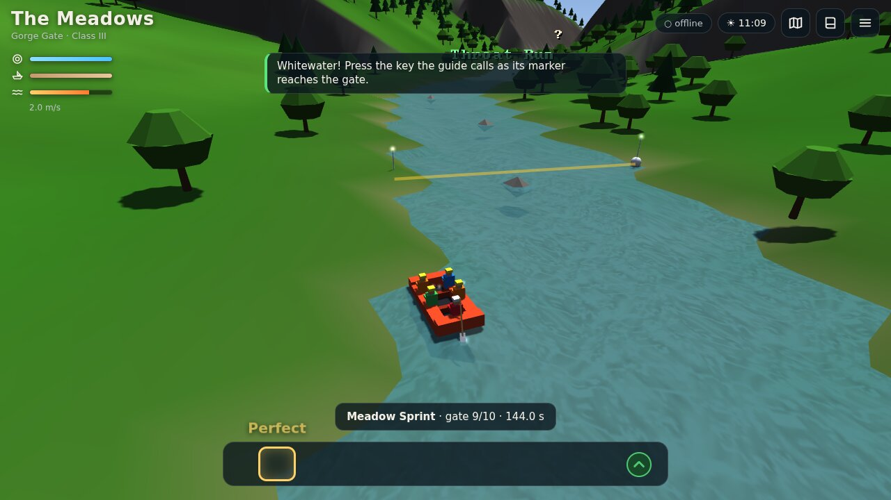 | 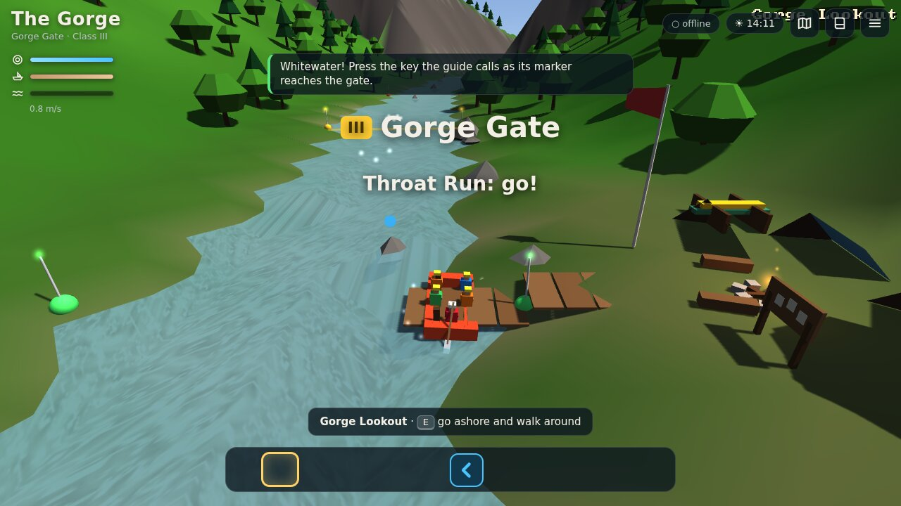 |
| **Later in the rapid.** | **The go-ashore prompt.** |
| 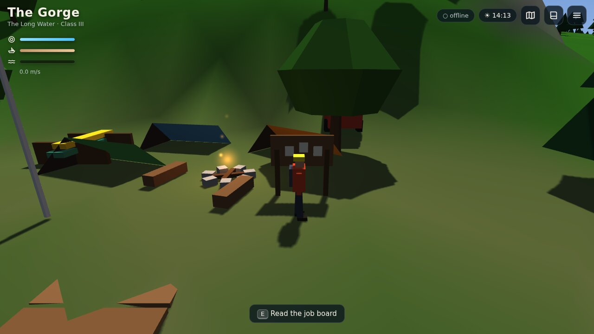 | 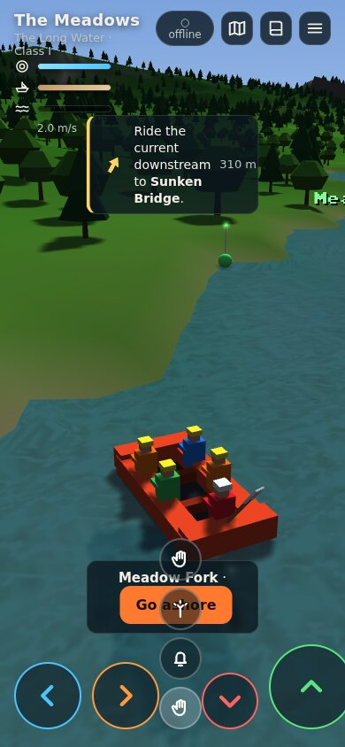 |
| **Walking ashore.** | **Phone: the signals button.** |
| 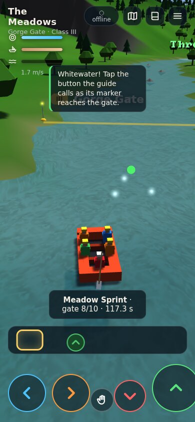 | 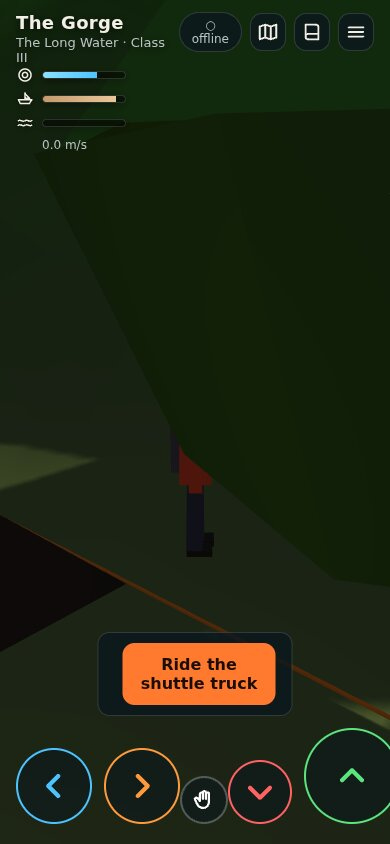 |
| **Phone: in a rapid.** | **Phone: ashore.** |
| 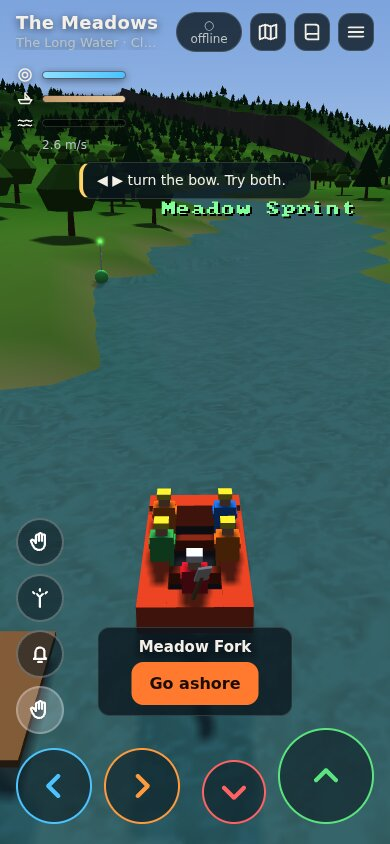 | 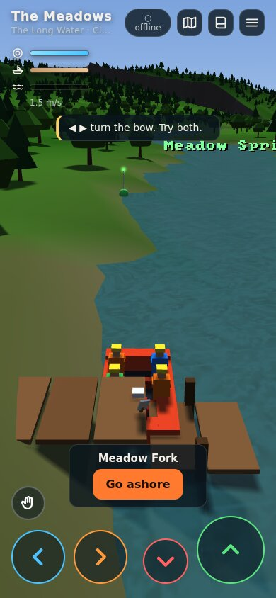 |
| **Phone (portrait): signals.** | **Phone (portrait): camp prompt.** |
| 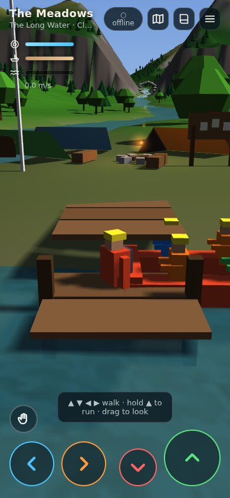 | 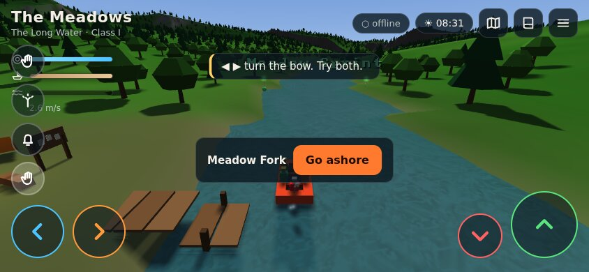 |
| **Phone (portrait): ashore.** | **Phone (landscape): signals.** |
| 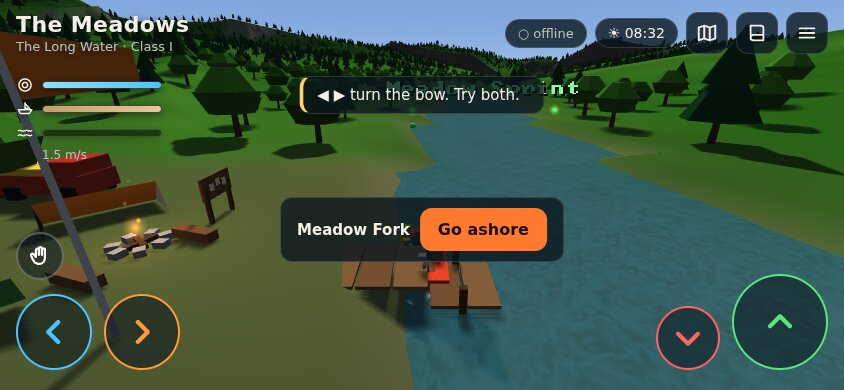 | 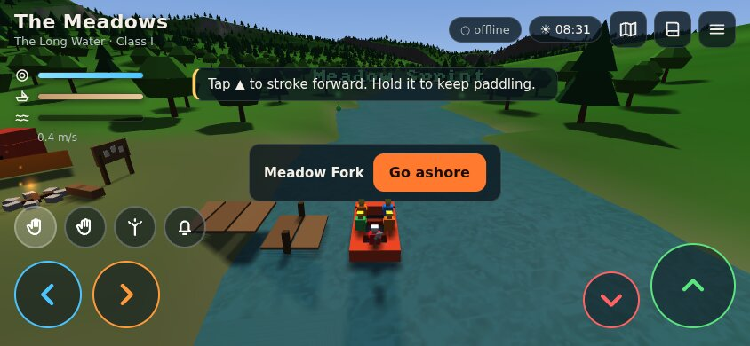 |
| **Phone (landscape): camp prompt.** | **Phone held sideways: signals.** |
| 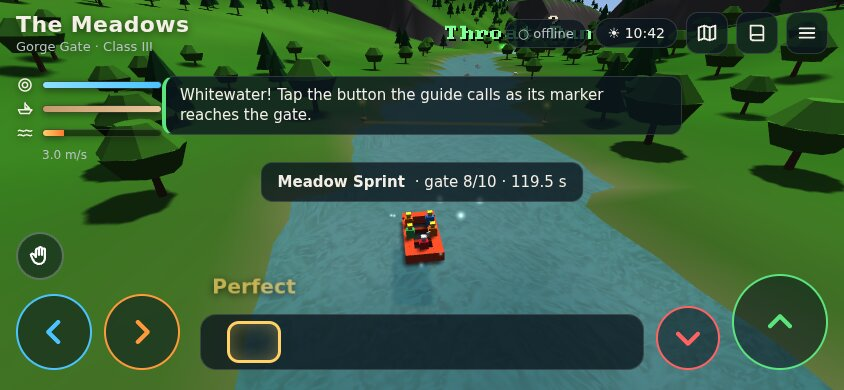 | 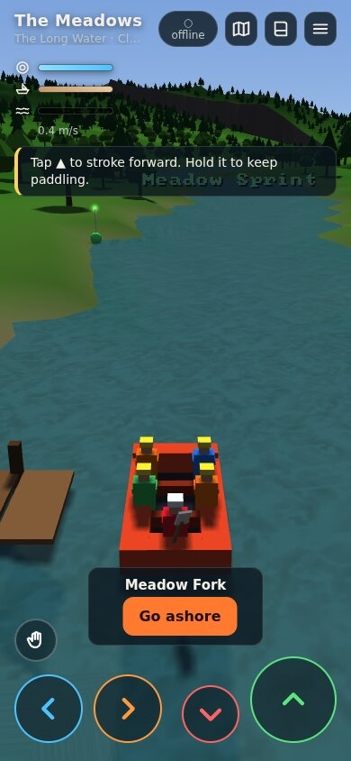 |
| **Phone held sideways: a rapid.** | **Phone (portrait): prompt.** |
| 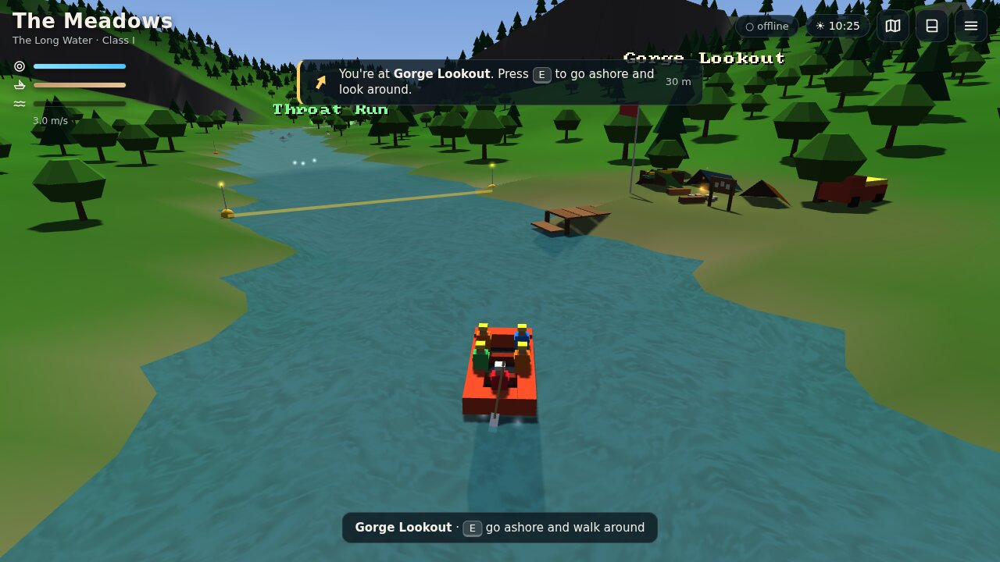 | |
| **Gorge Lookout on the flat water above Gorge Gate.** | |

These stills come from the feel lane's build, before the new boats were merged.
