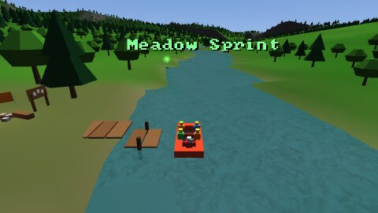
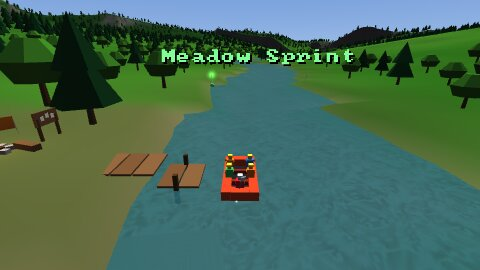
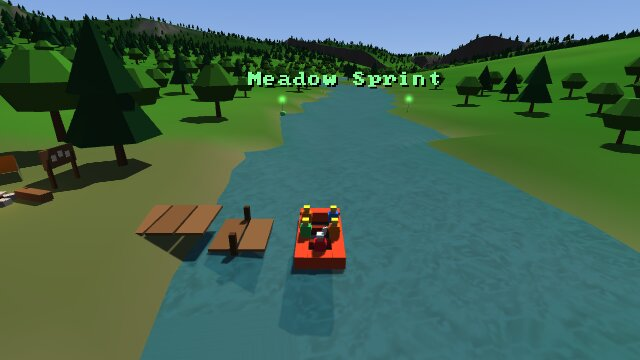
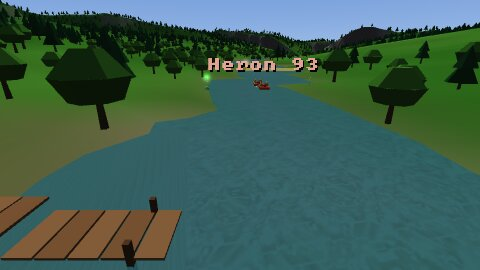
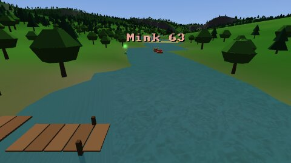
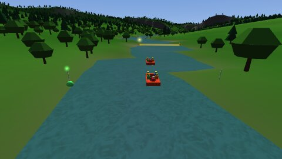
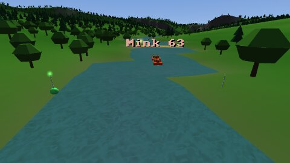

# Robustness and perf playtest (0.2.0)

Date: 2026-11-24, branch `local/f2-robust`, local only (nothing pushed).
Headless Chromium with SwiftShader (no GPU) on a shared WSL box whose load
average sat at 65-115 the whole session, so **every timing here is relative**
(the same box, back to back), not what a player sees. Nothing has run on a real
GPU or phone yet.

Scripts: `chaos.cjs` (multiplayer, relay kill, saves, blocked files) and
`perfprobe.cjs` (boot and frame timing) in this folder. Raw results:
`chaos-mp-save.json`, `chaos-errors.json`.

## Perf

### World generation in Node (no browser)

| preset | grid | worldgen | forest meshes | forest vertices |
|---|---|---|---|---|
| tiny | 257² | 130 ms (quiet box) | - | - |
| small | 513² at 6 m | 342 ms (quiet), 1.2 s (load 72) | 2.5 s (load 72) | 2.28 M (27k trees, density 0.3) |
| full | 1025² at 3 m | 1.3 s (quiet), 13.8 s (load 90) | 20.6 s (load 90) | 7.62 M (91k trees) |

The forest, not the terrain, is the slowest part of start-up: about twice the
worldgen time at the same load, and it ran on the main thread after the
engine loaded, with the loading bar frozen. It now builds in the world worker
while the engine downloads. Its size is the main phone risk: the full world's
7.6 M forest vertices are roughly 360 MB of vertex data (positions, normals,
colours, uvs); the small world's are about 110 MB. Phones keep getting the
small world, and the lowest detail tier thins it to 0.18 density.

### In the browser (small world, same box, alternating runs)

| run | boot to first frame | worldgen + forest (worker) | main-thread init | JS frame median / p95 (drive) |
|---|---|---|---|---|
| before #1 | 4844 ms | (not measured) | init + forest (~3.1 s) | 0.5 / 2.7 ms |
| after #1 | 4575 ms | 3201 ms | 1118 ms | 0.4 / 4.8 ms |
| before #2 | 4532 ms | | | 0.4 / 2.4 ms |
| after #2 | 4323 ms | 3055 ms | 1053 ms | 0.3 / 2.6 ms |

Boot is about 5% faster here because the engine comes from localhost in
200 ms; over a real network the forest now overlaps the wasm download, so the
saving grows with download time. The main thread is blocked for about 1.1 s
at the end of loading instead of about 3 s. The game's own JS per frame is
under 1 ms median: frame cost is GPU fill and draw, which the kit's adaptive
pixel density and shadow tier already handle, and which only real hardware
can measure. The full world did not finish booting within 15 minutes under
SwiftShader at load 90 (before and after), so it is not in this table.

`?perf=1` now shows these numbers live (world, detail, gen/engine/init/boot
ms, JS frame avg/p95/max, the kit's frame ms, quality, DPR, primitive and
point counts, tree count, frame errors).

## Multiplayer: two clients on a local relay (`node server/main.js` on 8794)

Two browser contexts on the tiny world, `?drive=1` with the sim pumped by hand
(SwiftShader drew about one frame a second at this load).

| step | result |
|---|---|
| A online | 3.3 s after load |
| A and B both online | 8.1 s |
| B sees A's live boat samples | yes |
| A's bell reaches B | yes |
| group start at Meadow Sprint (R at the start buoy on both) | race started on both |
| relay SIGKILLed mid-race | both clients offline 274 ms later |
| race after the relay died | still running on both; game time kept advancing (3 s in 3 s); no page errors |
| relay restarted after ~4 s down | both clients back online 6.0 s later without a reload; B sees A again |

Stills: `mp-race-a.jpg`, `mp-race-b.jpg`, `mp-relay-down.jpg`, `mp-reconnected.jpg`.

### Wave 2: a lobby and a finish with the relay gone (`ONLY=race`, `chaos-offline-race.json`)

| step | result |
|---|---|
| R at the Meadow Sprint buoy while online | lobby open, prompt "waiting for the group start" |
| relay SIGKILLed in the lobby | 24 ms later: toast "Lost the river relay: the group start is off. Solo start in 5 s.", solo countdown |
| the countdown | the solo run starts |
| finishing while the relay is still down | 14 ms, no hang: personal best kept, run on the local board, ghost upload queued (`f2.ghosts.queue`), toast "Offline: your run is saved here and will go to the online board when you reconnect." |
| relay restarted | client back online; the queue is flushed straight away. This synthetic run fails the board's gate check (422), so it is dropped rather than retried, as designed; a real run is posted (see the `runs queued while offline` server test) |

Fixed on the way: a group start subtracted the relay's elapsed
**milliseconds** from the game clock in **seconds** (`races.js`), so on a
120 ms link a group racer's clock started 120 s in (their time came out 120 s too slow), and the lobby toast showed
milliseconds as seconds and the ready list as ids.

## Chaos

| case | before this lane (from the 0.1.0 code; not re-run) | now |
|---|---|---|
| corrupt `f2.save.v1` with a good backup | save silently lost: `JSON.parse` failed, the game started fresh and the next autosave overwrote it | backup from 2026-11-20 loaded (canoe, pay kept), toast "Your save was damaged, so the backup from ... was loaded.", damaged text kept in `f2.save.v1.corrupt` |
| corrupt save, no backup | lost | fresh start, toast says the old save is kept on the device; damaged text in `.corrupt` |
| a field from a newer build (`futureField`) | dropped on the next write | kept |
| storage throwing on every call | worked (no save) | boots; `write()` returns false; one toast |
| wasm request fails | loader fallback with the raw "Failed to fetch" | "Forward Two didn't finish downloading. Check your connection and try again." plus Try again (618 ms) |
| wasm 404 | engine crash message from fetching an HTML 404 as wasm | same download message, "HTTP 404" in small print |
| garbage wasm | raw Emscripten abort text | "The game's engine failed to start on this device." plus Try again |
| no `WebAssembly` (iOS Lockdown Mode) | raw ReferenceError | explains that WebAssembly is switched off; no retry button |
| world worker blocked | boot rejected: error screen | builds on the main thread; boots (4.3 s on tiny) |
| `src/game/game.js` blocked | blank page forever | `src/guard.js` shows the download message plus Try again (1.9 s) |
| `engine/strata-loader.js` blocked | blank page | own error panel plus Try again (now worded as a download failure) |
| an exception in 5 frames | the render loop stopped for good (frozen picture) | 5 errors logged, loop still running; after 90 failing frames in a row the error screen appears |

## Follow-ups worth doing

- Test on a real phone (small world) and a desktop GPU with `?perf=1&fps=1`.
- Forest vertex count: instancing (one tree mesh, per-tree transforms) or
  per-chunk distance culling would cut the 110-360 MB to a few MB. That lives
  in the render lane's `meshes.js` and the C++ bridge.
- The `MeshBuilder` uses plain JS arrays then copies to typed arrays; writing
  straight into growable typed arrays would roughly halve the forest build.

## Wave 2b: no second copy of the forest in the wasm heap

`engine/bridge.cpp` kept a `std::vector` copy of every mesh so it could re-upload
after a lost WebGL context. Big static meshes (the forest) now drop that copy
(`f2_mesh_drop_copy`); after a restore the slot reports itself missing
(`f2_mesh_missing`) and the page hands the data back (`f2_mesh_refill`). The
page rebuilds the forest in the world worker from the seed (not from the
in-game world: `places.build()` flattens the camps after the forest is made, so
rebuilding from it moved trees). `?meshcopy=1`, or an older wasm without the new
exports, keeps the old path.

Build (local; the committed wasm is rebuilt again at integration):

```sh
# emsdk 6.0.11 (emcc a0014542110d6078c3a1a7941fa1ddb3a2281f16), Strata 0.10.0 tarball (SHA-checked by the script)
export EMSDK_PYTHON=<python 3.12>          # emsdk_env.sh needs >= 3.10, then unsets it,
source /root/emsdk/emsdk_env.sh            # so set it before and after sourcing
export EMSDK_PYTHON=<python 3.12>
nice -n 10 bash tools/build-engine.sh      # about 1-2 min here
```

The unchanged `bridge.cpp` rebuilt byte for byte identical to the committed
wasm and glue first, so the toolchain matches. The new wasm is 1,063,742 bytes
(+919) and the glue 82,150 (+128).

Context loss, small world, `?drive=1`, `WEBGL_lose_context` loseContext then
restoreContext (`ONLY=ctx`, `chaos-context-loss.json`):

| | wasm heap after boot | copies dropped | meshes before → after | restore | pixels changed (same scene time) | page errors |
|---|---|---|---|---|---|---|
| new (default) | **84.8 MB** | 90.8 MB | 31 → 31 | 16 forest meshes rebuilt, 43 s wall at load ~56 | 4.14% | 0 |
| `?meshcopy=1` (old path) | 175.9 MB | 0 | 31 → 31 | from the engine's copies, 0.5 s | 4.15% | 0 |

The heap is 52% smaller. The same 4.1% of pixels differ in both modes (spray
and foam are random each frame), so the rebuilt forest matches: see
`ctx-nocopy-before.jpg` and `ctx-nocopy-after.jpg`. On the full world the
saving is the forest's whole copy, about 300 MB (the full world wasn't run
headless). The cost: after a context loss the trees come back when the worker
finishes (worldgen plus forest, about 1-3 s on a quiet machine; 43 s on this
overloaded box), rather than at once. The first headless attempt rebuilt the
forest from the in-game world and the trees moved; that is why it now goes
through the worker.

## Screenshots

| | |
|---|---|
|  |  |
| **Before a lost WebGL context.** | **After the context comes back: the forest rebuilt from the seed.** |
|  |  |
| **The forest without uvs: unchanged on screen.** | **Group race: player A.** |
|  |  |
| **Group race: player B.** | **The relay goes down mid-race.** |
|  | |
| **Reconnected.** | |
